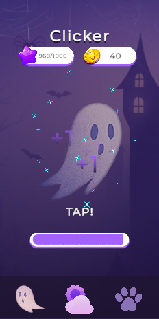
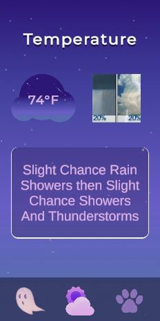
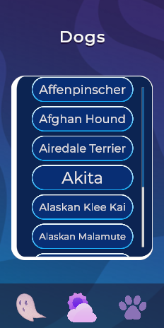
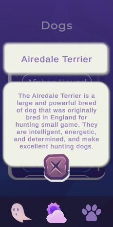

# 🎮 Unity Test Task

<p align="center">
  <b>A mobile-oriented application built with Unity 6 and C#</b>
  <br/>
  An interactive application featuring a Clicker, Weather Forecast and Dog Breeds browser.
</p>

<p align="center">
  
  
  
  
  
  
</p>

---

## 📌 About the Project

This project was developed as a Unity developer test assignment using **Unity 6**.

The application combines three independent features accessible through a bottom navigation menu:

- 🪙 **Clicker** — an interactive game with currency, energy management and visual effects.
- 🌤️ **Weather** — weather forecast retrieved from an external API.
- 🐶 **Dog Breeds** — a browser for dog breeds with detailed information.

The project demonstrates modular architecture, dependency injection, asynchronous programming, network request management and UI development.

---

## 📸 Screenshots

<p align="center">
  
  
  
  
</p>

<p align="center">
  <sub>Clicker · Weather · Dog Breeds · Breed Details</sub>
</p>

---

## ✨ Features

### 🪙 Clicker

An interactive clicker game with a currency and energy system.

**Gameplay:**
- Manual clicking to earn currency.
- Automatic clicking every 3 seconds.
- Energy consumption for each click.
- Automatic energy regeneration every 10 seconds.
- Configurable gameplay parameters using ScriptableObject.
- Starting currency and energy configuration.

**Visual effects:**
- Animated button interactions.
- Floating currency rewards with randomized positions.
- Particle effects.
- Click sound effects.
- Real-time currency and energy counters.
- Energy progress bar.

### 🌤️ Weather

Weather information retrieved from the National Weather Service API.

**Features:**
- Weather forecast information.
- Temperature displayed in Fahrenheit.
- Weather description.
- Dynamic weather icon loaded from the API.
- Automatic forecast updates every 5 seconds while the Weather tab is active.
- Request cancellation when leaving the Weather tab.

### 🐶 Dog Breeds

A dog breed browser powered by Dog API v2.

**Features:**
- Fetches a list of 10 dog breeds.
- Loading indicator while retrieving data.
- Interactive breed list.
- Detailed information displayed in a popup.
- Breed name and description.
- Loading indicator while fetching breed details.
- Previous detail requests are cancelled when selecting another breed.
- Requests are cancelled when leaving the Dogs tab.

---

## 🏗️ Architecture

The project follows the **Model-View-Presenter (MVP)** architectural pattern.

### Main Components

| Component | Responsibility |
|---|---|
| Model | Stores application data and handles business logic. |
| View | Handles UI presentation and user interactions. |
| Presenter | Connects Model and View and coordinates feature logic. |
| Services | Handles external API communication. |
| RequestQueue | Manages sequential execution of network requests. |
| Installer | Configures dependency injection bindings. |

### Dependency Injection

**Extenject (Zenject)** is used for dependency injection and object composition.

Dependencies are registered through installers rather than being manually instantiated throughout the application.

### Network Request Management

All API requests are processed through a shared `RequestQueue`.

The queue provides:

- Sequential request execution.
- Request enqueueing.
- Request cancellation.
- Result retrieval through request handles.
- Prevention of outdated requests from updating the UI.

### Asynchronous Operations

**UniTask** is used for asynchronous operations and cancellation handling.

**UnityWebRequest** handles HTTP communication with external APIs.

---

## 🛠️ Technologies & Tools

| Technology | Usage |
|---|---|
| Unity 6 | Game engine |
| C# | Programming language |
| Extenject (Zenject) | Dependency injection |
| UniTask | Asynchronous operations |
| DOTween | UI animations |
| UnityWebRequest | HTTP communication |
| TextMeshPro | UI text rendering |
| Unity UI | User interface |

---

## 🌐 External APIs

### Weather — National Weather Service

[https://api.weather.gov/](https://api.weather.gov/)

Forecast endpoint:

```text
https://api.weather.gov/gridpoints/TOP/32,81/forecast
```

### Dog API v2

[https://dogapi.dog/docs/api-v2](https://dogapi.dog/docs/api-v2)

Used to retrieve dog breed lists and individual breed information.

> An active internet connection is required for Weather and Dog Breeds features.

---

## 📂 Project Structure

```text
Assets/
│
├── Scenes/
│
├── Scripts/
│   ├── Core/
│   │   ├── Bootstrap/
│   │   ├── Navigation/
│   │   └── Installers/
│   │
│   ├── Infrastructure/
│   │   └── Network/
│   │
│   ├── Features/
│   │   ├── Clicker/
│   │   ├── Weather/
│   │   └── Dogs/
│   │
│   └── Common/
│       ├── UI/
│       └── Utilities/
│
├── Prefabs/
│
├── ScriptableObjects/
│
├── UI/
│
├── Sounds/
│
├── Materials/
│
└── Fonts/
```

---

## 🚀 Getting Started

### Requirements

- Unity 6
- Git
- Internet connection for API-dependent features

### Installation

1. Clone the repository:

   ```bash
   git clone <repository-url>
   ```

2. Open Unity Hub.

3. Select **Add Project from Disk** and choose the cloned project folder.

4. Open the project using Unity 6.

5. Open the `MainScene` scene from the `Scenes` folder.

6. Press **Play** to run the application.

---

## 🎯 Project Goals

The main goals of this project were to demonstrate:

- Practical C# and Unity development skills.
- Understanding of MVP architecture.
- Dependency injection with Extenject.
- Asynchronous programming with UniTask.
- Sequential network request management.
- Request cancellation and lifecycle handling.
- UI development, animations and visual effects.
- Integration with external REST APIs.

---

<p align="center">
  <b>Developed with Unity 6 and C#</b>
  <br/>
  <i>Unity Developer Test Assignment</i>
</p>
